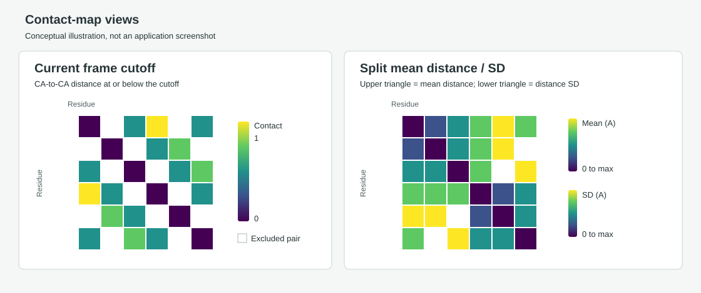

# PyMOL Contact Map Plugin

**Version v9**
**Purpose:** inspect residue contacts and residue-pair distances for structures and trajectories loaded in PyMOL.

The plugin opens a separate window inside your PyMOL session. It reads the selected molecular object, updates as you change frames, and can save the displayed plot as an image. It does not alter the molecule's coordinates or write changes to your structure or trajectory files.



*Illustration only, not a screenshot. In the split view, mean distances occupy the upper triangle and distance standard deviations occupy the lower triangle.*

## What You Can Plot

Choose a view from the **Plot** menu in the plugin window:

| Plot option | What is displayed | Atoms and frames |
| --- | --- | --- |
| **Current frame cutoff** | Binary CA-distance map: yellow means within the cutoff; purple means outside the cutoff or excluded. | Frame selected by the plugin's Current frame slider. |
| **Current frame residue distances** | Choose all-atom residue-center distances or CA-to-CA distances. Upper/Lower cutoffs mask colors without changing the fixed palette Range. | Frame selected by the plugin's Current frame slider. |
| **Mean + standard deviation** | One statistics view with **Show mean** and **Show standard deviation** checkboxes. Display either statistic alone or both side by side. | The inclusive First-Last selection in the plugin, using the selected distance definition. |
| **Split mean / SD across diagonal** | Mean distance in the upper triangle; standard deviation in the lower triangle. Each statistic has its own cutoff controls and fixed palette Range. | The inclusive First-Last selection in the plugin. |

The separate Mean and SD dropdown entries were removed in version 1.7.0. Select **Mean + standard deviation**, then choose the statistic(s) to display within that view. In split mode both triangles remain present; their profiles and color ranges can still be controlled independently.

For both statistics layouts, the **Distance definition** dropdown selects what is measured in each frame:

| Definition | Per-frame residue-pair measurement |
| --- | --- |
| **C-alpha to C-alpha** | Distance between the two residues' CA positions; the default. |
| **Residue center to center (all atoms)** | Distance between geometric, equally weighted centers of all loaded protein atoms in each residue, including loaded hydrogens. Not a mass-weighted center. |

Both mean and population SD use the selected measurement across the First-Last frames. Changing the definition or selected frame range recalculates both statistics. Current frame residue distances has its own CA/residue-center selector, defaulting to residue centers. Current frame cutoff always uses CA distances.

The closest-residue-distance option is temporarily unavailable in the dropdown. Residue centers now use all loaded atoms rather than a heavy-atom-only selection. The plugin does not add missing atoms or hydrogens; when no hydrogens are present in the input, the center uses the atoms that are available. Current-frame center plots, temporal mean/SD, and frame exports use the same all-atom definition.

Every heatmap shows its column residue labels along the **top** edge and row residue labels along the **left** edge in the same order. Matching residues therefore start together near the upper-left corner. This applies to cutoff, center-distance, combined, split, and exported frame heatmaps. Line plots keep their existing residue-axis orientations.

The dedicated **Line plots** section contains **Show mean line plot** and **Show SD line plot**. Both are optional and initially unchecked. In the combined view each line plot appears below its own heatmap, with residues on the x-axis. The mean line's y-axis is **Mean of means (A)**: the average of eligible pairwise mean distances for that residue. The SD line's y-axis is **Mean of SDs (A)**: the average of eligible pairwise distance SDs, not an SD calculated from the mean line.

In split mode the selected line plots appear horizontally below a compact heatmap, with residues on the x-axis. With both enabled, Mean is on the left and SD on the right in one bottom row, with separate titles and axes and a clear gap between them. Showing only one profile gives it the full row. The smaller heatmap and shorter cutoff bars leave more room for the profiles; smaller windows can scroll, and exports include the full canvas. Profiles omit self-pairs and neighbor-filtered pairs. Both honor Mean cutoffs; **SD cutoffs additionally filter its line and profile CSV.** Empty selections create gaps rather than zeros. Lines have no circle markers, and color scaling never changes raw matrices.

Every mode offers **Export…**. Statistics views also offer **Export range** beside their First/Last slider; current-frame views show only their scrubber and Play/Pause. The same export window supports ranges, specific frames, multiple structures, and separate side-by-side image/CSV selections. Its copyable PyMOL command includes the chosen outputs and frame selection. Matrix CSVs retain raw values; profile CSVs contain the cutoff-filtered averages used by the lines.

## What's New in v9

- Context-specific navigation: current-frame modes show only frame browsing and Play/Pause; combined/split statistics show only First/Last selection and Export range.
- Main-window frame-range changes recalculate Mean, population SD and both profiles. The export window also previews its selected range, interval or exact frame list in the main plots, with a short 150 ms debounce. The latest selection is recalculated before export; edits made during a calculation queue a fresh update.
- In statistics views, **Statistics for selected frames** exports the recalculated aggregate data, not individual-frame distance maps. Mean/SD heatmap and profile CSV choices remain available. A one-frame selection has zero population SD.
- **Select images for export** and **Select CSVs for export** are independent lists. Export Mean heatmap, SD heatmap, Mean line, SD line and, in split mode, the split heatmap as separate image files. **Current view** is an optional image choice, not the only output.
- Cutoffs satisfy **0 <= Lower <= Upper <= Range**. Decreasing a manual or automatic Range clamps Upper down if necessary, and Lower is clamped to Upper. Auto range still controls only the palette maximum; cutoff edits do not disable it.
- Canceling export options restores the original statistics selection/settings. Each checked structure is exported using the chosen frame selection, and copied commands retain the same images, CSVs and aggregate-frame options.

## What's New in v8

- Viridis uses an independent **0-to-Range scale**. **Auto range** controls only that palette maximum, following the data maximum rounded up to two decimals. Uncheck it to enter a fixed Range for comparisons across frames and structures. Upper/Lower stay independently editable; toggling Auto range or dragging a cutoff never changes the other settings. Above Upper is **light gray**; below Lower is **dark gray**. Log mode uses `log(1+x)`.
- Added **Play/Pause** beside the main Current frame slider. In Current frame cutoff and Current frame residue distances, it cycles through all loaded frames, updates the heatmap and frame controls, and loops back to frame 1. It is disabled for statistics views and single-state objects.
- Split Mean/SD profiles now appear side by side below the matrix: Mean on the left, SD on the right. Showing one profile uses the full bottom row. The heatmap is capped at 340 pixels square and the cutoff bars are shorter to leave more room for the horizontal profiles. This changes layout only; profile values and CSV contents are unchanged.
- Export frame selection now explicitly offers **Frame range** or **Specific frames**. Selecting either option grays out the other option's inputs; only the selected option is used for export and the copied PyMOL command. Inputs are preserved when switching, with no silent override or fallback.
- The split Mean/SD view places its Mean and SD cutoff controls in separate side-by-side columns to the right of the plots, instead of stacking them in one overlapping column.
- The split canvas reserves dedicated sidebar space for the raised control groups and one spacious bottom row for the selected horizontal profiles. Smaller windows can scroll; image exports include the full canvas.
- Cutoff calculations, frame navigation, distance definitions, and export data remain unchanged from v7.

## What's New in v7

- Range is read-only and always equals **Upper cutoff minus Lower cutoff**. It updates as either cutoff bar moves. Viridis uses `0` to that derived Range; cells above Upper are dark gray, while cells below Lower are light gray. The same rules apply to Mean, SD, and Current frame residue distances.
- Renamed Current frame residue-center distances to **Current frame residue distances**, with selectable all-atom residue centers or CA-to-CA distances.
- Added two frame controls to the main plugin window in every plot mode: a First/Last range slider plus Export range, and a separate single-handle Current frame scrubber. Current-frame heatmaps update without switching back to the PyMOL viewer. Mean/SD use the selected First-Last frames.
- Binary cutoff legend labels are **within cutoff** and **outside cutoff**, not contact/no contact.
- Fixed frame-range and single-frame editing, enabled frame CSV toggling, and made checked structure rows toggle once per click. Export range prefills the common export window. Copied commands retain the source object, viewing frame range, distance metric, and cutoffs.

## Browse Frames in the Plugin

In combined and split statistics views, **First/Last** selects the inclusive ensemble used for Mean, population SD and both profiles. Drag either handle or edit the fields to recalculate the plots. **Export range** opens export options with those bounds selected. This control is not shown in either current-frame mode.

In Current frame cutoff and Current frame residue distances, the **Current frame** scrubber and frame field inspect one state, and Play/Pause animates the ensemble. These controls are hidden in statistics views, where a current-frame position would not represent the aggregate calculation. Current-frame modes still support range/specific-frame exports through Export options.

Click **Play** beside this slider to animate Current frame cutoff or Current frame residue distances. The button changes to **Pause** while playing. Playback starts from the displayed frame, advances through the entire loaded ensemble, and wraps from the last frame to the first; the First/Last statistics/export range does not restrict it. The refresh timer advances one frame per tick (nominally 350 ms; large systems may be slower). Click Pause or scrub manually to stop. Changing objects, switching to Mean/SD or split statistics, refreshing objects, closing the plugin, or a plot error also stops playback. Opening the export options pauses the timer; canceling resumes the previous playback state.

## What's New in v6

- Each Mean/SD colorbar has three separate values: **Upper cutoff**, **Lower cutoff**, and **Range**. The draggable cutoff bars sit directly over the viridis scale; the scale itself always runs from zero to Range. Moving cutoffs does not recolor retained values by stretching the palette between the cutoffs.
- Restored SD cutoff filtering of the SD line and its CSV, in addition to the shared Mean pair-selection filter.
- Moved Export toward the center of the toolbar. Its single window supports multiple protein structures, a top dual-handle frame slider, intervals, exact selections such as `50,200`, and single frames.
- PNG/JPEG images and matching CSVs export separately for each checked structure. Frame selections are validated for every structure before files are written; frame-only exports avoid full-trajectory aggregate calculations.
- The destination-specific command at the bottom can be copied and pasted directly into PyMOL. It uses single-line Python syntax starting with `/` and the same export backend as the window.

## What's New in v5

- Temporarily removed the closest-residue-distance dropdown option.
- Residue centers average all loaded protein atoms, including any hydrogens present, in current-frame calculations, temporal statistics, and frame exports.
- Column residue labels appear at the top of every heatmap, matching the left-axis order. Line-plot axes are unchanged.
- Mean and SD colorbars each have draggable upper/lower cutoff handles, precise numeric fields, and a third value at the midpoint of the full scale. Moving the upper handle turns off Auto max; lower handles cannot cross upper handles. The full scale stays anchored to the data maximum, or a larger manually entered upper value.
- SD line profiles respond only to Mean cutoffs, not SD cutoffs. Lines are marker-free, wider, and taller, with scrolling when needed.
- Image exports use an off-screen snapshot instead of rendering live controls. Typed destination folders are created as needed; incomplete current-view bundles are removed on failure. PNG/JPEG and frame-series exports remain available.

## What's New in v4

- Mean and SD lower/upper numeric limits sit directly beside the corresponding viridis bar: upper bound at the top, lower bound at the bottom. Log/Linear and Auto max are located there too.
- Mean limits act as a shared residue-pair filter. The corresponding cells in SD turn dark gray below Mean's lower bound, or light gray above Mean's upper bound. These pairs no longer contribute to the SD line profile.
- For pairs inside the Mean range, SD's own limits and color scale still apply independently. Mean exclusions take precedence when both filters exclude a pair in different directions.
- All changes update the heatmaps and line profiles immediately using cached raw statistics; no manual Refresh click is needed.
- Cutoff contacts have a genuinely binary, two-color legend. Adjust the cutoff with the slider or numeric field at that legend; it no longer occupies a top-row control.
- Export actions share one popup, top rows use compact spacing, and smaller plot areas can scroll instead of cropping line plots. Exported images include the complete canvas, not just its visible scroll viewport, and omit interactive control widgets.

## Install and Open

### Requirements

- PyMOL with its bundled Qt interface and NumPy. Matplotlib is not needed.
- A protein object loaded in the PyMOL session. The plugin does not load files itself.
- For trajectory analysis, one PyMOL object with multiple states. A multi-model PDB naturally loads as multiple states; a separate trajectory must be attached to a compatible topology.

### One-time use in a PyMOL session

1. Start PyMOL and open the structure or trajectory you want to analyze.
2. Locate PyMOL's command input area. These are **PyMOL commands**, not PowerShell commands.
3. Load the plugin by executing the following block. `runpy.run_path` is used because the Windows folder path contains spaces:

   ```pymol
   python
   import runpy
   runpy.run_path(r"C:\Users\yagd9\Documents\Stony Brook AI Drug Discovery\Github\Pymol-Public\contact map\__init__.py")
   python end
   ```

4. Open the window:

   ```pymol
   contact_map_gui
   ```

The window is called **Protein Contact Map**. Running `contact_map_gui` again raises the existing window if it is already open. The plugin also defines a **Contact Map** menu item when installed through a PyMOL plugin manager that supports this plugin format.

You need to load the plugin once per PyMOL session unless you install it permanently through your PyMOL build's Plugin Manager. Reopening PyMOL clears commands loaded with the one-time method.

### Load a protein and trajectory

For a separate topology and trajectory, first load the topology and then attach its matching trajectory to the same object:

```pymol
load "D:/data/protein.gro", protein
load_traj "D:/data/trajectory.xtc", protein
```

Use the actual paths to your files. Forward slashes are convenient in PyMOL commands on Windows; quote paths that contain spaces. Your PyMOL build must support the formats, and the topology and trajectory must have matching atom counts and ordering.

For an ensemble PDB that contains `MODEL`/`ENDMDL` records, load it as one object; each model becomes a state:

```pymol
load "D:/data/ensemble.pdb", ensemble
```

You can open the contact-map window before or after loading data. If you load an object after opening it, click **Refresh objects** to update the object list.

## First-use Walkthrough

Follow these steps once the data is loaded in PyMOL and the **Protein Contact Map** window is open.

1. **Select the object.** Open the **Object** dropdown and choose the protein or trajectory object. CA plots require CA atoms; center statistics use all loaded protein atoms. If the object is missing from the list, click **Refresh objects**.
2. **Check the frame count.** The label below the controls shows the current frame and total states for a current-frame plot. A single-state structure can show one frame; aggregate mean and SD then have only that one observation.
3. **Start with a current-frame view.** Choose **Current frame cutoff** to display a binary contact map for the frame PyMOL is currently showing. The status text reports the number of CA residues and contacts.
4. **Adjust the cutoff at its legend.** The cutoff starts at `8.0 A`. Use the vertical slider or numeric field beside/below the binary colorbar. Yellow is **1: within cutoff**; purple is **0: outside cutoff**. Excluded neighbors and self-pairs also use `0`. This is a binary classification, not a continuous distance gradient.
5. **Choose the neighbor exclusion.** **Exclude same-chain neighbors** now starts at `0`, so no off-diagonal sequence neighbors are excluded by default. Increase it only if you want to omit nearby same-chain entries in the selected residue order. Self-distances stay zero in distance matrices and are excluded from profile averages.
6. **Inspect current-frame distances.** Choose **Current frame residue distances** and select all-atom residue centers or CA-to-CA under Distance definition. Residue centers average all loaded protein atoms, including any hydrogens. This view has its own Upper/Lower bars and independent fixed Range, using the same filtering and colors as the statistics views.
7. **Move through the trajectory.** Current-frame views show a scrubber, frame field and Play/Pause. Statistics views instead show First/Last and Export range; moving these handles recalculates both heatmaps and profiles. The navigation groups are mutually exclusive.
8. **Open statistics.** Choose **Mean + standard deviation**. Initially both **Show mean** and **Show standard deviation** are checked. Uncheck either to enlarge the other plot; if both are unchecked, the window asks you to select a statistic.
9. **Choose the distance definition.** Select CA-to-CA or **Residue center to center (all atoms)**. Mean and SD both use that definition. The status line reports frame progress during the first calculation.
10. **Set the scale and cutoffs.** Auto range follows the data maximum; uncheck it for a manual Range. Viridis runs from 0 to Range. Drag Upper/Lower to mask colors without changing Range. Limits are inclusive and satisfy `0 <= Lower <= Upper <= Range`. If Range decreases below Upper, Upper clamps to Range; Lower cannot exceed Upper.
11. **Show line plots.** Check **Show mean line plot** and/or **Show SD line plot**. Both start off and can be toggled independently. In the combined view, keep the corresponding heatmap visible to see its line beneath it. The Mean line averages means passing Mean cutoffs. The SD line averages pairwise SDs passing **both Mean and SD cutoffs**. Adjusting either pair-selection cutoff updates the affected lines immediately. Exclusions do not contribute zeros. Log/Linear changes only colors and slider positions. Lines have no point markers and use expanded plotting areas. If a small window cannot show the full canvas, use the plot-area scrollbars.
12. **Compare both statistics in one matrix.** Choose **Split mean / SD across diagonal**. Read the upper triangle as mean distance and the lower triangle as distance SD.
13. **Choose scales independently.** Choose Log or Linear beside each viridis bar. Mean may use Log while SD uses Linear. In split mode, selected profiles appear below the heatmap. Selecting both places Mean on the left and SD on the right, with separate axes and a clear gap.
14. **Read the gray exclusions.** Below Lower is **dark gray**; above Upper is **light gray**. Mean exclusions apply to both maps; SD's cutoffs additionally filter its colors and profile. Structural exclusions remain white. Excluded pairs do not contribute to the corresponding line; raw matrix CSVs remain unchanged.
15. **Export images and data.** Open Export, check the desired structures, and choose a destination. Use the independent image and CSV lists to choose exactly which outputs to save. Statistics images can be exported individually, even when their corresponding plots are hidden in the main view. Clear all CSVs for images only, or disable images for CSVs only.
16. **Choose export frames.** Select Frame range (First/Last/Interval) or Specific frames (`50,200` or `50`); the inactive inputs gray out. In current-frame modes, these produce individual-frame files. In statistics modes, they define the ensemble for the live preview and aggregate outputs. Heatmap and profile CSVs remain selectable throughout.

The plugin does not change coordinates or input files. Statistics weight the selected First-Last states equally and are cached by object, state count, distance definition, neighbor exclusion, and frame bounds. Display cutoffs and visibility reuse those statistics. Click Refresh objects after modifying coordinates to clear cached results.

## Export Selected Frames and Statistics

Open Export in any view, or Export range in statistics views. Choose one or more loaded structures, a destination, frame selection and outputs in that one window. The starting plot mode determines whether selected frames produce individual-state files or one recalculated statistics bundle per structure.

### Choose what each frame represents

| Starting plot mode | What the selected frames produce |
| --- | --- |
| Current frame cutoff | Binary CA within/outside-cutoff map using the current cutoff and neighbor filter. |
| Current frame residue distances | CA-to-CA or all-atom residue-center map, as selected in that view. |
| Mean + standard deviation or Split mean / SD | Aggregate Mean, population SD and profiles calculated from the selected states, using the chosen distance metric. |

In statistics mode, range, interval and specific-frame selections all define the aggregate ensemble. A selection of `50,200` averages those two states only; selecting `50` gives the frame's mean distances and zero temporal SD. This is different from the individual-state export used by current-frame modes.

### Live statistics preview

The export window's statistics selection updates the main heatmaps and profile data after a short debounce. Read-only **Mean**, **SD**, **Mean line**, **SD line**, and (in split mode) **Split** tabs also preview the plots directly inside the export window. These tabs use the same renderers as the individual image files. A status identifies the source object and selected-frame count. Main-window checkboxes control main-window line visibility only; profile previews and exports remain available when those lines are hidden. Current-view scope uses the original ensemble. Invalid selections disable Export; canceling restores the original settings. The accepted selection is recalculated before writing, and other checked structures use that same selection for their own calculations.

### Select images and CSVs

The two lists stay available side by side for statistics selections. Image choices are **Mean heatmap**, **SD heatmap**, **Mean line plot**, **SD line plot**, and **Split Mean/SD heatmap** in split mode. Each selected image is rendered as its own plot without unrelated panels or controls. **Current view (all visible plots)** is optional if a whole-canvas image is wanted. PNG and JPEG are supported.

CSV choices include raw Mean/SD matrices, cutoff-filtered Mean/SD residue profiles, and the split matrix in split mode. These choices do not disappear when changing the statistics frame range. Images and CSVs are generated from the same recalculated selection, regardless of which main-window plots are currently visible.

### Export steps

1. Select the molecular **Object**. Only frames/states already loaded in PyMOL are available.
2. Select the starting mode and distance metric. Current-frame modes export each requested state separately. Statistics modes export the Mean/SD ensemble calculated from those states.
3. Configure the neighbor exclusions, palette Ranges and cutoffs. Choose which line profiles are visible if a main-window preview is wanted; their CSVs and individual images can be exported even when hidden.
4. In statistics mode, use Export range or choose Statistics for selected frames. In current-frame mode, choose Selected frames in Export options.
5. Click **Browse…** beside Destination and choose a writable folder, or enter a path. Missing destination folders are created automatically when permissions allow.
6. Check the desired **Protein structures**, then choose exactly one frame-selection option. **Frame range** enables the slider and First/Last/Interval fields; for example, First `10`, Last `100`, Interval `1` exports frames 10 through 100 inclusive. **Specific frames** enables only the frame-number field; enter `50,200` to export those two frames or `50` for one frame. The other option's controls are grayed out, and retained values in disabled fields are ignored. Switching options preserves both sets of inputs. Numbering is one-based loaded PyMOL states, not simulation timestamps. Selections are validated for every checked structure before writing files.
7. In statistics mode, check the desired image and CSV datasets independently. In current-frame mode, choose images and/or matching frame matrix CSVs. Choose PNG or JPEG under Image format. At least one output is required.
8. Click Export. Per-frame exports show frame progress; statistics exports write the selected aggregate images and CSVs once per checked structure. Playback pauses during export operations.
9. Wait for completion or press **Cancel**. Cancellation is checked between frames; the current frame's calculation may finish before cancellation takes effect.
10. Read the status line for each structure's output directory. A uniquely named subfolder is created per checked structure inside your destination. Earlier exports are not overwritten. Canceling stops the remaining batch; completed frames remain saved. The original object selection, PyMOL frame, view mode, timer, and playback state are restored afterward.

### Output files and interpretation

Each completed frame has the same base filename for its PNG and CSV, for example:

```text
protein_centers_frame_000001.png
protein_centers_frame_000001.csv
protein_centers_frame_000002.png
protein_centers_frame_000002.csv
```

The CSV contains the raw residue-by-residue matrix for that exact frame, with labels on both axes. Contact CSVs contain `0`/`1`; distance CSVs contain Angstroms with `NA` for structurally excluded neighbors. Color transforms and display limits affect PNGs but do not clip the CSV numbers. Files are saved after each frame, not held until the whole batch finishes. If writing the current frame fails, its incomplete PNG/CSV pair is removed; earlier completed frames remain.

With **Auto range off**, Range stays fixed across frame images and checked structures. With Auto range on, the selected data determines Range; Upper and Lower clamp downward only when needed to satisfy the bounds. Changing only cutoffs never rescales retained values. The binary view stays a two-color classification. Raw CSV values are never clipped.

## Export Any Plot as CSV

### Choose the data and destination

1. Select the **Object** and the **Plot** mode. Wait until the calculation completes without an error.
2. Set the current frame for a frame-based plot, or the distance definition and neighbor filter for a statistics plot.
3. If exporting a line profile, set **Mean** cutoffs for the Mean profile and **both Mean and SD** cutoffs for the SD profile.
4. Open Export. In statistics mode choose the desired frame selection or Current view scope, then check the CSV datasets. All statistics CSV choices remain available while selecting frames:

| Plot mode | CSV choices |
| --- | --- |
| Current frame cutoff | **Within-cutoff matrix (0/1)** |
| Current frame residue distances | Matrix for the selected CA-to-CA or all-atom residue-center metric |
| Mean + standard deviation | **Mean CSV**, **SD CSV**, **Mean residue profile**, **SD residue profile** |
| Split mean / SD across diagonal | All four statistics choices plus **Split matrix (upper mean / lower SD)** |

5. Choose the destination folder with Browse and check one or more Protein structures. Check precisely the CSV datasets you want; multiple selections are allowed. Clear **Save plot image** for CSV-only output.
6. Click the window's **Export** button. The plugin creates a unique subfolder for each structure and writes its selected files there. The status line reports the paths. Canceling the options window writes nothing.
7. You can save the current PNG/JPEG in the same operation. The old separate on-window CSV selector and export buttons are no longer needed.

Profiles are available for export even when their display checkboxes are off, and Mean/SD CSVs remain available when either heatmap is hidden. Split-mode profiles export the same residue/value data as the combined layout. Moving the profiles below the matrix does not change their calculations or CSV format. No data are available to export when there is no valid object or the plot has a calculation/range error.

### Heatmap CSV format

Heatmaps export square matrices. The first row contains column residue labels; the first column contains row residue labels. Both axes follow the same residue order as the plot. Numeric values are saved with up to 12 significant digits.

```csv
residue,A:ALA1,A:ALA2,A:ALA3
A:ALA1,0,12,20
A:ALA2,12,0,8
A:ALA3,20,8,0
```

This example is a mean-distance matrix in Angstroms. A cutoff-contact matrix instead contains binary `0`/`1` values. In cutoff mode, excluded neighbors and self-pairs are represented as `0`, matching the binary map. For distance matrices, unavailable neighbor-filtered pairs are `NA`, while self-distances are `0`.

The split matrix exports the raw mean values above the diagonal, raw SD values below it, and zero mean self-distances on the diagonal. Both statistics have units of Angstroms, but the split matrix is not symmetric and does not represent a single symmetric distance measure. Export Mean and SD separately if you need two complete symmetric matrices.

Heatmap exports are **not** transformed by Log/Linear scaling or clipped to display limits. Dark/light gray cells still retain their raw numeric values. Matrix exports do not contain image colors, per-frame coordinates, or an extra line-profile column.

### Line-plot CSV format

Mean and SD profiles export one row per residue and two columns: residue label and the plotted column-average value.

```csv
residue,column_mean_distance_angstrom
A:ALA1,12
A:ALA2,12
A:ALA3,NA
```

The Mean profile's value column is `column_mean_distance_angstrom`; the SD profile uses `column_mean_distance_sd_angstrom`. The SD profile is the average of eligible pairwise distance SDs, not the SD of the mean profile.

Self-pairs and neighbor exclusions do not contribute. Both profiles exclude pairs outside Mean's cutoffs; the SD profile also excludes pairs outside SD's cutoffs. `NA` means no eligible partners remain, not zero. Cutoffs affect profiles without changing Range. Auto range, manual Range, Log/Linear and profile visibility do not change cutoff values or profile selection.

### Filenames and reproducibility

Output filenames include the object and dataset. Current-frame filenames include the loaded frame number; statistics filenames include `ca` or `centers`. Each export uses a new subfolder so previous files are not overwritten. Record the distance definition, loaded states, neighbor exclusion, and ranges alongside CSVs; these are not embedded as metadata rows. Playback and automatic frame refresh are paused while the export popup is open.

## Export From the PyMOL Command Line

The bottom of the same Export window contains a read-only, selectable **PyMOL command** and **Copy** button. Choose the destination, checked structures, frames, image format, and CSVs first; the command updates immediately. Copy the complete line, close or cancel the options window, and paste it into PyMOL's command line after loading this plugin. Canceling the options window does not invalidate the command.

The generated command includes the destination, source object, exact statistics selection, palette Ranges, cutoffs, metric, image keys and CSV keys. `aggregate_frames=True` means selected frames define a statistics ensemble; `False` means individual-state export. It uses PyMOL's leading `/` for single-line Python execution and escapes destination paths automatically.

A shorter example exporting both images and CSVs is:

```pymol
/__import__('pymol').contact_map_export(destination=r"C:\MD_exports", objects=['protein_A', 'protein_B'], frames='10-100', mode='frame_centers', metric='centers')
```

Use `frames='50,200'` for those two frames, or `frames='50'` for one. `frames=None` exports current-view images and datasets instead. PNG is the default; `image_format='jpg'` selects JPEG. Set `save_image=False` for CSV-only output or `save_csv=False` for images only. The command and window use the same exporter and require the named structures and requested states to be loaded in the current PyMOL Qt session.

For selected-frame aggregate outputs, use `mode='both'` or `mode='split'`, `aggregate_frames=True`, and `images=['mean','std','mean_profile','std_profile']` as desired. CSV keys use the same four names, with `split` additionally available in split mode. Omitting `images` preserves the legacy whole-view image for command compatibility; the export window supplies explicit image choices.

## How the Measurements Work

### Current-frame cutoff contacts

For CA coordinates $\mathbf{x}_i$ and $\mathbf{x}_j$, the contact is present when

$$
\lVert \mathbf{x}_i - \mathbf{x}_j \rVert_2 \leq c,
$$

where $c$ is the cutoff in Angstroms. The map is symmetric. Same-chain neighbors within the selected sequence-order exclusion and the diagonal are omitted.

### Current-frame residue distances

For each residue, the plugin averages the coordinates of all its loaded protein atoms, including hydrogens when present, to get a geometric center:

$$
\mathbf{r}_i = \frac{1}{N_i}\sum_{a=1}^{N_i}\mathbf{x}_{ia}.
$$

With residue centers selected, the pair distance is $\lVert\mathbf{r}_i-\mathbf{r}_j\rVert_2$ in the current frame. This is a geometric center, not a mass-weighted center or closest-atom distance. With CA-to-CA selected, distances use CA positions instead. Both choices support independent fixed Range, Upper/Lower masks, scrubbing and selected-frame export.

### Mean and standard-deviation distances

For residue pair $i,j$ over $F$ object states, let $d_{ij}^{(f)}$ be the selected CA or all-atom center-to-center distance in frame $f$. The mean distance is

$$
\bar d_{ij} = \frac{1}{F}\sum_{f=1}^{F} d_{ij}^{(f)}.
$$

The plugin displays the **population** standard deviation:

$$
\sigma_{ij} = \sqrt{\frac{1}{F}\sum_{f=1}^{F}\left(d_{ij}^{(f)}-\bar d_{ij}\right)^2}.
$$

The side summaries report the overall mean of the eligible pair distances and overall population SD, or summaries of per-pair SDs. Diagonal self-pairs and excluded same-chain neighbors are omitted from these summaries.

Side summaries describe raw eligible distances, not only colored pairs. Both profiles honor Mean cutoffs; SD additionally honors its own cutoffs. Filtering occurs after temporal statistics. Both the main First/Last control and the export window's statistics selection update the aggregate plots and profiles. Exact frame lists and intervals use only the selected states, with equal weighting.

## Color Scales and Range

In Mean, SD, and Current frame residue distances, each colorbar lists **Upper**, **Lower**, and an independent **Range**. Viridis always maps raw values from zero to Range. Moving a cutoff changes masking only. Mean and SD have separate Range settings and Auto range checkboxes. Keep Auto range off for identical color correspondence across frame changes and exports.

**Auto range** sets Range from the data maximum, rounded upward to two decimals, and disables manual Range editing while checked. Uncheck it for a fixed manual scale. Upper/Lower remain editable and cutoff changes do not disable Auto range. All controls enforce `0 <= Lower <= Upper <= Range`: decreasing Range clamps Upper, and decreasing Upper clamps Lower. This applies to automatic Range decreases too, such as a one-frame SD becoming zero.

- **Log** maps retained values using $\log(1+x)/\log(1+R)$, where $R$ is Range; zero remains valid when permitted by the cutoffs.
- **Linear** maps retained values using $x/R$. An all-zero Range uses the first viridis color.
- Below Lower: dark gray `(80, 80, 80)`; above Upper: light gray `(210, 210, 210)`. These colors also appear below/above the handles on the colorbar. Mean exclusions take precedence over SD's own cutoff colors. Boundaries are inclusive.
- Mean and SD each retain their own settings when switching between the combined and split layouts. A degenerate all-zero SD range renders valid zeros with the first viridis color.
- The binary cutoff legend uses purple for `0: outside cutoff` and yellow for `1: within cutoff`. The adjacent slider and Cutoff field adjust the threshold in Angstroms. There is no continuous viridis scale in this mode. Self-pairs and excluded neighbors use `0`.

White denotes structurally unavailable pairs. Self-distance zeros use viridis if Lower is zero, or dark gray if Lower is positive. The cutoff view stays binary.

## Controls at a Glance

| Control | Default | Applies to |
| --- | --- | --- |
| Object | First available molecular object | All views |
| Cutoff slider / field | `8.0 A`, on binary legend | Current frame cutoff only |
| Exclude same-chain neighbors | `0` sequence-order entries | All views |
| Plot | Current frame cutoff | All views |
| Color scale | Log, at each continuous bar | Distance/statistics views; cutoff mode is binary |
| Auto range | On | Sets Range from data; clamps Upper/Lower only if the resulting Range is smaller |
| Range | Automatic while Auto range is checked; manually editable when off | Independent viridis maximum; never follows cutoff edits |
| Show mean / Show standard deviation | Both on | Combined statistics view |
| Distance definition | C-alpha to C-alpha | Both statistics layouts |
| Show mean line plot / Show SD line plot | Both off, under Line plots | Combined: below each map; split: adjacent horizontal plots below the compact matrix |
| Mean colorbar | Log, Lower `0`, Auto range | Independent Range; Upper/Lower filter Mean and SD |
| SD colorbar | Log, Lower `0`, Auto range | Independent Range; SD cutoffs additionally filter its colors/profile |
| Current-distance colorbar | Log, Lower `0`, Auto range | Independent Range and cutoffs for CA or all-atom centers |
| Main First/Last slider | All loaded states | Statistics views only; live recalculation and Export range |
| Main Current frame slider | Current loaded state | Current-frame views only; hidden in combined/split statistics |
| Play / Pause | Stopped | Cycles all loaded frames in current-frame modes; disabled for statistics and single-state objects |
| Export… | Near the middle of the toolbar | One window with separate image/CSV lists, range preview and multiple structures |
| Frame range / Specific frames | Frame range | Mutually exclusive; inactive inputs are grayed out |
| PyMOL command / Copy | Bottom of Export window | Destination-specific command matching current export options |

## Requirements and Limitations

- PyMOL with its bundled Qt interface and NumPy. Matplotlib is not required.
- Contact and aggregate CA-distance views require protein CA atoms in the selected object.
- Residue-center distance view requires at least one eligible residue pair; centers average the protein atoms actually loaded for each residue. Missing hydrogens are not generated automatically.
- Aggregate views require matching selected residue identities across states. Segment, chain, residue number/insertion code, and residue name distinguish residues.
- The plugin analyzes coordinates already loaded into PyMOL. It does not align, transform, or modify those coordinates.
- Large trajectories can take time to calculate the first aggregate map. Progress is shown in the status line; subsequent requests with the same object and neighbor setting use cached statistics.
- An empty map can result when the object has no protein residues, or when the same-chain neighbor exclusion removes every eligible pair.
- Closest-pair distance is not currently offered in the dropdown. No external analysis package is required for the available metrics.
- Distances are ordinary Cartesian Euclidean distances, without periodic minimum-image correction. Unwrap/repair broken molecules before loading if appropriate for the trajectory.
- Profiles use a linear numeric distance axis and are not changed by the heatmap's Log/Linear transform. A missing point means no partners remain after Mean cutoffs and, for the SD profile, SD cutoffs; it is not a distance of zero.

## Version History

| Version | Incremental changes |
| --- | --- |
| **1.0.0** | Initial live CA contact map with object selection, distance cutoff, same-chain neighbor exclusion, frame refresh, and a separate PyMOL Qt window. |
| **1.1.0** | Added plot saving, viridis coloring, and aggregate plot controls. The first aggregate implementation used contact occupancy; this was replaced in 1.2.0. |
| **1.2.0** | Corrected aggregate plots to mean CA-pair distance and distance SD; added the optional split-diagonal view and zero-based logarithmic color mapping. |
| **1.3.0** | Added square Log/Linear controls, Auto max, and a user-set maximum range with clipping. |
| **1.4.0** | Separated the current-frame cutoff contact map from a new current-frame residue-center distance map based on geometric centers of non-hydrogen protein atoms. |
| **1.5.0** | Added optional per-residue column-average profiles below mean and SD heatmaps, plus independent scale mode and maximum controls for each split-diagonal half. |
| **1.6.0** | Added optional labeled CSV export for Mean distance and Distance standard deviation matrices. Excluded/filtered matrix entries are represented as `NA`. |
| **1.7.0** | Consolidated mean/SD into one selectable statistics view; added CA, heavy-atom-center and closest-heavy-atom metrics; independent Min/Max and Log/Linear controls in both statistics layouts; gray below/above-range cells; range-filtered profiles; split SD profile below and mean profile right; zero default neighbor exclusion; tightened Object spacing and retained raw CSV exports. |
| **1.8.0** | Added destination-selectable CSV exports in every plot mode: current-frame cutoff and residue-center matrices, raw mean/SD matrices, the combined split matrix, and range-filtered Mean/SD residue profiles. |
| **v2** | Moved the optional line-plot checkboxes to a dedicated Line plots section, labeled the mean-of-means and mean-of-SDs axes explicitly, added a Residue label beneath each line plot, and tightened the Cutoff label/input spacing. Release renamed to v2; functionality unchanged. |
| **v3** | Renamed the third distance definition to closest inter residue atomic distance. Added optional frame-series PNG/CSV export with a destination chooser, frame range/interval, progress and cancellation, unique output folders, and restoration of the original session state. |
| **v4** | Consolidated export into one upper-right dialog with multiple CSV selection and frame ranges; moved live range/scale controls onto the colorbars; linked Mean pair-selection bounds to SD heatmap/profile exclusions; added a binary cutoff legend with an on-bar slider/field; compacted the header and made the full plot area scrollable. |
| **v5** | Temporarily removed the closest-distance option; changed residue centers to include all loaded atoms, including hydrogens; moved column residue labels to the top of every heatmap. Added draggable Mean/SD cutoff handles, Mean-only SD profile filtering, expanded marker-free line plots, and isolated off-screen export rendering with failed-bundle cleanup. |
| **v6** | Separated Upper/Lower cutoff bars from zero-to-Range viridis scales; restored SD cutoff filtering of SD profiles; moved Export toward the toolbar center; added multiple-structure current/frame exports, a top frame-range slider, explicit/single-frame selection, PNG/JPEG output, and a live copyable destination-specific PyMOL command. |
| **v7** | Made Range equal Upper-Lower; changed exclusions to dark above Upper/light below Lower; added main First/Last and frame-scrubbing controls plus prefilled Export range; used selected frames for statistics; added CA/center selection and cutoff bars to Current frame residue distances; revised binary labels; fixed export frame bounds and checkbox toggles; compacted the command footer. |
| **v8** | Moved the split view's Mean/SD cutoff controls into separate right-side columns, reserved space clear of both line plots, and retained full-canvas image exports and scrolling. |
| **v9** | Context-specific frame navigation; live range/exact-state statistics previews in the main and export windows; selected-ensemble heatmap/profile CSVs; separate named image/CSV choices; independent image rendering; enforced Lower-Upper-Range bounds. |

## Troubleshooting

**I cannot see the line plots.** Select **Mean + standard deviation**, keep the desired heatmap(s) checked under Show mean / Show standard deviation, and enable the corresponding **Show mean line plot** / **Show SD line plot** checkboxes under **Line plots**. These options start unchecked and are separate from the CSV selector. If the new section is absent, restart PyMOL and load the updated plugin file; an already-open window from a previously loaded version does not acquire new controls automatically.

**The object menu is empty.** Load a molecular object in PyMOL and press **Refresh objects**.

**The plot says no protein CA atoms were found.** This view requires protein residues with CA atoms. Check the selected object and loaded state.

**The current-distance view has too few pairs.** Reduce **Exclude same-chain neighbors** or select an object with more protein residues. The view needs at least one eligible pair for the selected CA/center metric.

**A map has gray cells.** Light gray is above Upper; dark gray is below Lower. Raw matrix CSVs retain the numbers. Mean exclusions remove pairs from both profiles; SD exclusions additionally remove pairs from the SD profile.

**A profile has gaps or is empty.** No off-diagonal partners survive the filters. Check Mean cutoffs for either line and SD cutoffs for the SD line. Widening SD cutoffs cannot restore pairs excluded by Mean. Gaps are not zero.

**A cutoff changes when Range decreases.** This is intentional: Upper cannot exceed Range, and Lower cannot exceed Upper. Auto range can give SD Range zero for a one-frame selection, so its cutoffs clamp to zero too. Turn Auto range off and increase Range if a larger fixed scale is needed.

**Both statistics disappeared.** Check at least one of Show mean / Show standard deviation in the combined view.

**CSV export is disabled.** Load/select a valid molecular object and fix any calculation or range errors. The selector lists only datasets for the current plot mode. Profile exports do not require enabling their display checkboxes.

**The CSV contains values above the displayed maximum.** This is intentional for heatmap matrices: exports preserve raw numbers. Select a residue-profile export to obtain the range-filtered averages used in a line plot.

**I want individual-frame maps rather than aggregate statistics.** Start in Current frame cutoff or Current frame residue distances, then choose Selected frames in Export. Starting in Mean/SD or split statistics instead exports the selected ensemble's aggregate images and CSVs.

**Line plots do not all fit on the screen.** The smaller header leaves more plot space. If necessary use the plot area's scrollbars; exports still save the entire canvas. No line-plot data are dropped because a window is small.

**I cannot find the frame exports.** Look at the final status message for the new subfolder created inside your chosen destination. Completed frames are written one by one. An empty subfolder can remain if cancellation or an error occurs before the first frame is saved.

**A selected structure has fewer frames.** The range slider uses the common loaded-state count of checked structures. Exact frames must exist in every checked structure; uncheck shorter trajectories or change the selection. Validation failures occur before batch files are written.

**The copied command does not run.** Load the plugin in this PyMOL session, then paste the complete line beginning with `/`. Do not replace that prefix with `python`; that opens a multi-line block instead of executing the one-line command.

## Run the Tests

From the repository root in PowerShell, use a Python interpreter bundled with PyMOL:

```powershell
& "C:\Users\yagd9\AppData\Local\Schrodinger\PyMOL2_new\python.exe" -B -m unittest discover -s "contact map" -p "test_contact_map.py" -v
```

The tests use temporary synthetic structures rather than research trajectories. They check distance definitions, temporal means/SDs, gray cutoff colors, fixed zero-to-Range palette values, draggable cutoffs, filtered profiles, visibility controls, image/CSV exports, frame syntax, multi-structure destination files, early validation, cancellation, state restoration, and execution of the copied PyMOL command with an escaped destination path.

**The plot does not change while playing.** Confirm the object has multiple PyMOL states and that the global frame slider is moving. Current-frame views refresh from PyMOL's current frame.

**The plugin command is not found.** Load the plugin file first in the PyMOL session, then run `contact_map_gui`.